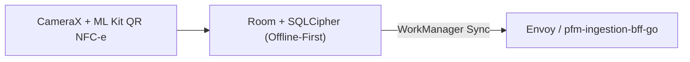

# PFM Mobile Android — Kotlin Offline-First (Jetpack Compose)

[](CONTRIBUTING.md)
[](CHANGELOG.md)
[](https://sorobanerp.github.io/pfm-docs/)

---

## 1. Visão Geral & Papel na Arquitetura

Aplicativo Android nativo **Offline-First** em **Kotlin + Jetpack Compose + Room/SQLCipher + CameraX**: leitura instantânea de QR Code NFC-e sem internet, fila local criptografada e sincronização resiliente via WorkManager.

- **Repositório:** `Sorobanerp/pfm-mobile-android`
- **Vínculo com `pfm-docs`:** `ADR-001, ADR-003, ADR-004 | US-07, US-14`



---

## 2. Pré-requisitos & Variáveis de Ambiente

### Pré-requisitos
- JDK `17` / `21` e Android SDK (API 34+)
- Gradle Wrapper (`./gradlew`)

### Variáveis de Ambiente (Sem Segredos Hardcoded)
| Variável / BuildConfig | Padrão Local | Descrição |
| :--- | :---: | :--- |
| `API_BASE_URL` | `http://10.0.2.2:18080/` | URL do Edge Gateway acessível pelo Emulador Android |

> **Segurança (Zero-Trust):** Nunca commite tokens, senhas, chaves AWS ou strings de conexão com credenciais reais. Utilize `.env` local (ignorado no `.gitignore`) ou AWS Secrets Manager / GitHub OIDC.

---

## 3. Como Executar Localmente

```bash
./gradlew assembleDebug
# Instalar no emulador conectado:
./gradlew installDebug
```

---

## 4. Como Testar e Validar

```bash
./gradlew testDebugUnitTest jacocoTestReport
./gradlew lintDebug
```

---

## 5. Como Provisionar / Validar na Nuvem

1. Fluxo Gitflow: `feat/*` $\rightarrow$ `develop` $\rightarrow$ `release/vX.Y.Z` $\rightarrow$ `main`.
2. O pipeline gera APK/AAB assinado e valida cobertura de testes $\ge 95\%$.

Consulte [CONTRIBUTING.md](CONTRIBUTING.md) para regras de Conventional Commits e [CHANGELOG.md](CHANGELOG.md) para histórico de versões.
